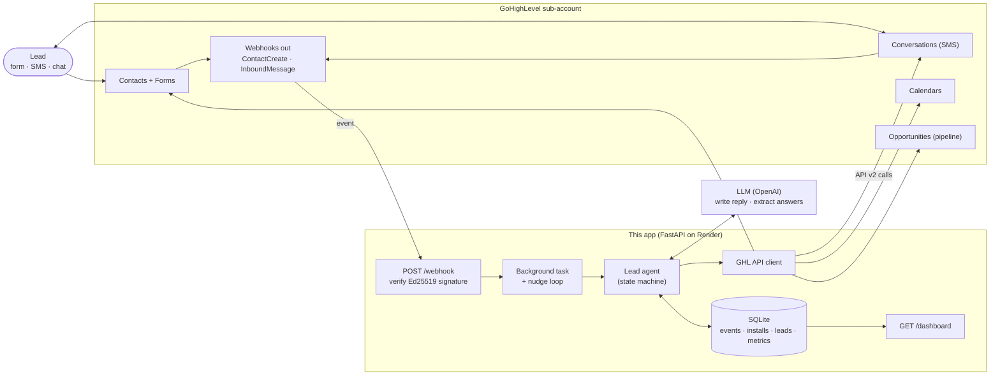
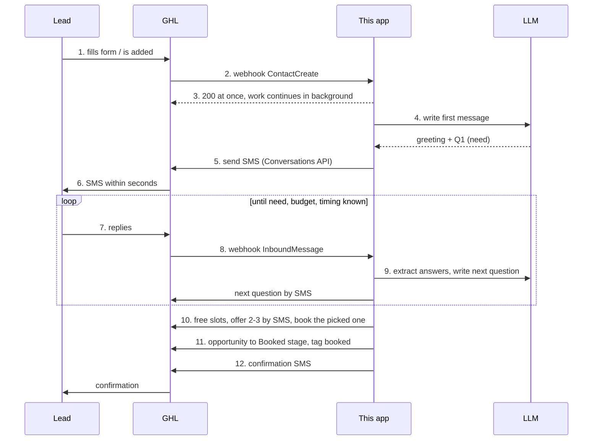
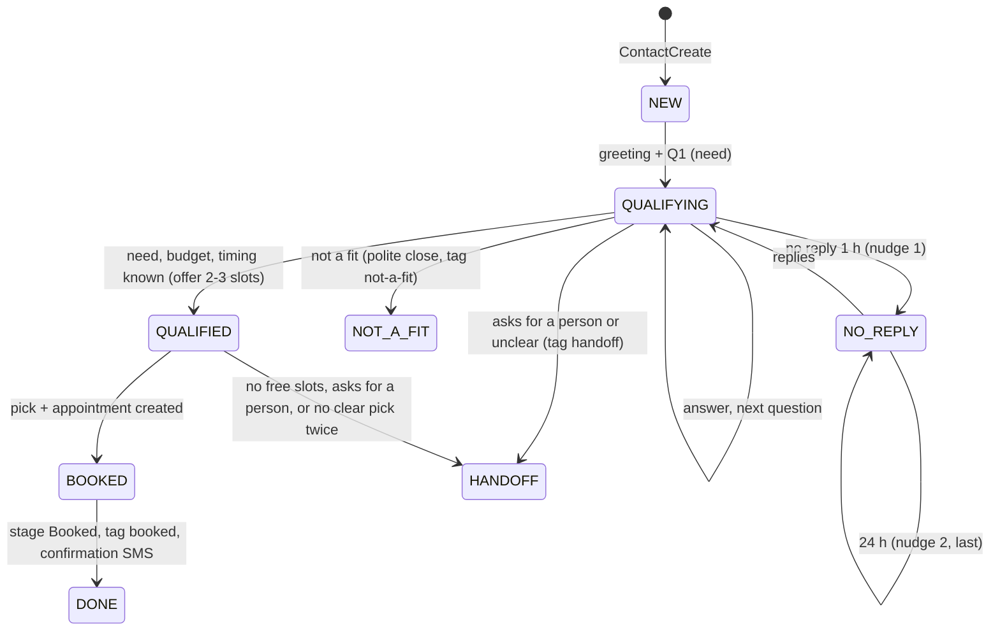
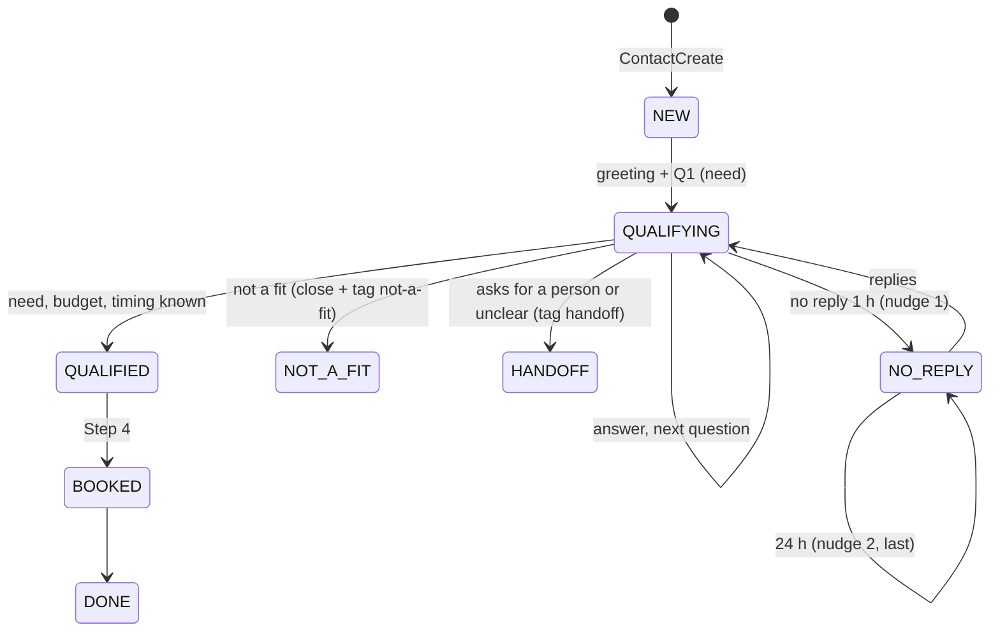
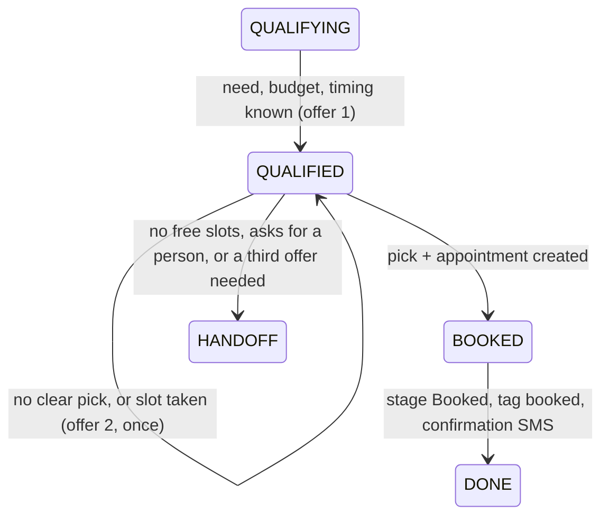

# AI GTM Engine

An AI go-to-market (GTM) engine on GoHighLevel: one pipeline from lead sourcing → enrichment → AI scoring → personalised outreach → reply routing → Speed-to-Lead booking in GHL. The Speed-to-Lead module is built and running; the earlier stages are planned and not built yet.

| Stage | Status |
|-------|--------|
| Lead sourcing | planned |
| Enrichment | planned |
| AI scoring | planned |
| Personalised outreach | planned |
| Reply routing | planned |
| Speed-to-Lead: SMS reply in < 60 s, AI qualify, booking, pipeline stage, OAuth install, dashboard | built |

## Speed-to-Lead module

A new GoHighLevel lead gets an AI text within seconds, is qualified by SMS, books a meeting on your calendar and lands in the **Booked** pipeline stage, with no one touching it.

Python + FastAPI. GoHighLevel (GHL) owns the contacts, messages, calendars and pipeline; this app only listens, decides and calls the [GHL API v2](https://marketplace.gohighlevel.com/docs/). Built in steps; each step's section below is a guide you can run yourself.

## Architecture



GHL owns the data; the app keeps only what its state machine and dashboard need. The webhook answers `200` at once and the work runs after the response, so GHL never waits on the LLM.

## Lead flow



## Qualify state machine

The LLM writes the words and reads the answers. `app/agent.py` owns the states and decides every move, so the agent never books, promises or tags anything on its own.



## Features

- **Instant first text.** `ContactCreate` → greeting + first question by SMS; the time from contact created to SMS sent is stored per lead (`first_reply_seconds`).
- **SMS qualifying.** Need, budget and timing, one question at a time; the LLM returns the answers as JSON and the code decides the next step.
- **Real booking.** Offers up to 3 free times from a GHL calendar, understands the pick in the lead's own words, books it, and handles a slot taken in the meantime.
- **Pipeline + tags.** Moves the opportunity to **Booked**; tags `booked`, `handoff` or `not-a-fit` so a person can filter in GHL.
- **Nudges.** One follow-up after 1 hour and one after 24 hours without a reply.
- **Safe webhooks.** Ed25519 signature check, duplicate deliveries skipped by `webhookId`, duplicate replies by `messageId`; contacts with Do Not Disturb are never texted.
- **Installable.** GHL OAuth app install flow, tokens encrypted at rest, refresh before expiry and one retry on `401`; a Private Integration Token works for a single account.
- **Dashboard.** Leads, median and p90 first-reply time, % qualified, % booked, last 20 leads (Step 6).
- **Tested offline.** Every GHL and OpenAI call is tested against the documented example responses; no test calls a real API.

## Stack

Python 3.11 · FastAPI · httpx · SQLite · `cryptography` (Ed25519 webhook check, Fernet token encryption) · OpenAI Responses API · GoHighLevel API v2 · Render (free web service) · pytest + respx · GitHub Actions CI.

## Run it

```bash
git clone https://github.com/Huy-Hieuu/ai-gtm-engine.git
cd ai-gtm-engine
python3 -m venv .venv && source .venv/bin/activate
pip install -r requirements-dev.txt
pytest -q                        # 56 passed, no keys needed
cp .env.example .env             # fill in from "What you need"
uvicorn app.main:app --reload
```

Then `curl localhost:8000/health` → `{"status":"ok"}`, and with `DASHBOARD_TOKEN` set, open `http://localhost:8000/dashboard?token=<DASHBOARD_TOKEN>`.

GHL can only reach a public URL, so for real leads deploy it: [Render](https://dashboard.render.com) → **New → Blueprint** → this repo. `render.yaml` creates the free web service, asks for the secrets and generates `DASHBOARD_TOKEN`. Steps 1-6 below walk through every setting.

## What you need

No passwords go in this repo; every secret lives in `.env` (git-ignored) or in Render → your service → **Environment**.

| What | Where to get it | Env var |
|------|-----------------|---------|
| GoHighLevel agency account with a sandbox sub-account | [gohighlevel.com](https://www.gohighlevel.com) (trial or developer sandbox) | |
| An SMS number in that sub-account | GHL → **Settings → Phone Numbers** | |
| Private Integration Token | GHL sub-account → **Settings → Private Integrations** (Step 1) | `GHL_PRIVATE_TOKEN` |
| Location (sub-account) id | GHL app URL, the part after `/location/` (Step 1) | `GHL_LOCATION_ID` |
| Calendar, pipeline and Booked stage ids | GHL API `GET /calendars`, `GET /opportunities/pipelines` (Step 4.3) | `GHL_CALENDAR_ID`, `GHL_PIPELINE_ID`, `GHL_BOOKED_STAGE_ID` |
| GHL Marketplace developer account + private app (webhooks and OAuth) | [marketplace.gohighlevel.com](https://marketplace.gohighlevel.com) → **My Apps** (Steps 2.3, 5.1) | `GHL_CLIENT_ID`, `GHL_CLIENT_SECRET`, `GHL_REDIRECT_URI` |
| Token encryption key | `python -c "from cryptography.fernet import Fernet; print(Fernet.generate_key().decode())"` (Step 5.2) | `APP_ENCRYPTION_KEY` |
| OpenAI API key | [platform.openai.com/api-keys](https://platform.openai.com/api-keys) (Step 3.1) | `OPENAI_API_KEY` |
| OpenAI model (optional) | default `gpt-6-luna` | `OPENAI_MODEL` |
| Business description (optional) | your own words, e.g. `a roofing company in Austin` | `BUSINESS_DESCRIPTION` |
| Dashboard token | any long random string; Render generates one from `render.yaml` (Step 6) | `DASHBOARD_TOKEN` |
| Database file (optional) | default `gtm_engine.db` | `DATABASE_PATH` |
| GHL API base (optional) | default `https://services.leadconnectorhq.com`; leave it | `GHL_API_BASE` |
| Render account linked to GitHub | [dashboard.render.com](https://dashboard.render.com) (Step 2.2) | |

## Results

> **To fill in** from the sandbox run: open `/dashboard` after the test leads and copy the numbers. Replace every `TO FILL`; until then nothing here is a measured result.

| Metric | Sandbox result |
|--------|----------------|
| Test leads | TO FILL |
| Median first reply (contact created → SMS sent) | TO FILL s |
| p90 first reply | TO FILL s |
| Qualified | TO FILL % |
| Booked | TO FILL % |
| Run date, hosting | TO FILL (e.g. date, Render free tier) |

Screenshot of the dashboard: TO FILL. Demo video: TO FILL (script in [`docs/loom-script.md`](docs/loom-script.md)).

## Layout

| Path | What it is |
|------|------------|
| `app/config.py` | The only place that reads environment variables (`.env`). |
| `app/ghl.py` | The only GHL API client: one small function per endpoint. |
| `app/db.py` | The only owner of the SQLite schema and queries (`events`, `installs`, `leads`, `metrics`). |
| `app/webhooks.py` | Webhook signature check and one handler per event type. |
| `app/agent.py` | The SMS agent: the only owner of lead states and transitions (Step 3). |
| `app/llm.py` | OpenAI calls: write one SMS, read a lead's answers as JSON (Step 3). |
| `app/dashboard.py` | The dashboard page: totals and the last 20 leads as HTML (Step 6). |
| `app/main.py` | FastAPI app (`GET /health`, `POST /webhook`, `GET /oauth/install`, `GET /oauth/callback`, `GET /dashboard`) and the nudge loop. |
| `app/hello.py` | Step 1 CLI. |
| `render.yaml` | Render free web service (Step 2). |
| `docs/loom-script.md` | 2-3 minute demo video script (Step 6). |
| `tests/` | Tests against JSON fixtures from the docs; no test calls the real API. |

## Step 1 - Hello API

Goal: prove the token works by listing contacts and sending one SMS.

### 1. Create a Private Integration Token

In your GHL sandbox sub-account:

1. **Settings → Private Integrations → Create new Integration.** (Not in settings? Enable it under Labs.)
2. Name it, e.g. `ai-gtm-engine`.
3. Select only these scopes:

   | Scope | Used by |
   |-------|---------|
   | `contacts.readonly` | `POST /contacts/search` (list contacts) |
   | `conversations/message.write` | `POST /conversations/messages` (send SMS) |

4. Copy the token. GHL shows it only once.

Your location (sub-account) id is the part after `/location/` in the GHL app URL.

### 2. Fill `.env`

```bash
cp .env.example .env
```

Set `GHL_PRIVATE_TOKEN` and `GHL_LOCATION_ID`. `.env` is git-ignored; never commit it.

### 3. Install (Python 3.11+)

```bash
python3 -m venv .venv
source .venv/bin/activate
pip install -r requirements-dev.txt
pytest -q
```

Expected: `56 passed`.

### 4. List contacts

```bash
python -m app.hello contacts
```

Expected: up to 10 lines of `id<TAB>name<TAB>phone`, for example

```
102goXVW3lIExEQPOnd3	john doe	+123456789
```

It worked if the names match the contacts in **Contacts** in GHL. Add a test contact with your own mobile number if the list is empty.

### 5. Send one SMS

Copy the id of a contact whose phone you own:

```bash
python -m app.hello sms 102goXVW3lIExEQPOnd3 "Hello from the API"
```

Expected: one line with the message id, for example `t22c6DQcTDf3MjRhwf77`.

It worked if the message shows in that contact's **Conversations** tab in GHL (and arrives on the phone, if the sub-account has an SMS number).

### If it fails

| Output | Fix |
|--------|-----|
| `error: GHL_PRIVATE_TOKEN is not set` / `GHL_LOCATION_ID is not set` | Fill `.env` (step 2). |
| `error: GHL rejected the token (401 ...)` | Token copied wrong, rotated, or missing the scope for that call. |
| `error: GHL /conversations/messages failed (400 ...)` | Read GHL's message; usually the contact has no phone or the sub-account has no SMS number. |

All GHL calls send `Authorization: Bearer <token>` and the `Version` header from the endpoint docs (`app/ghl.py`, `API_VERSION`).

## Step 2 - Webhooks

Goal: GHL tells the app about every new contact (`ContactCreate`) and every reply (`InboundMessage`) at a public URL. The app checks the request really comes from GHL, logs it, and skips resends.

How `POST /webhook` works:

1. Checks the `X-GHL-Signature` header: an Ed25519 signature of the raw body, verified with GHL's public key from the [Webhook Integration Guide](https://marketplace.gohighlevel.com/docs/webhook/WebhookIntegrationGuide) (`app/config.py`, `GHL_WEBHOOK_PUBLIC_KEY`). Missing or wrong → `401`. The legacy RSA `X-WH-Signature` header was retired on 2026-09-01 and is not accepted.
2. Event types without a handler → `200 {"status": "ignored"}`, nothing stored.
3. Stores the event in the SQLite `events` table keyed by GHL's `webhookId`. Already there → `200 {"status": "duplicate"}` and no second handling. GHL retries any non-2xx or timed-out delivery up to 12 times, so the same event can arrive more than once.
4. Answers `200 {"status": "accepted"}` at once, then runs the handler for that type after the response and sets `handled = 1`. The handlers log the event and pass it to the agent (Step 3).

### 1. Run locally (optional)

```bash
uvicorn app.main:app --reload
```

In a second terminal:

```bash
curl -i -X POST localhost:8000/webhook -H 'Content-Type: application/json' -d '{"type":"ContactCreate","webhookId":"test-123"}'
```

Expected: `HTTP/1.1 401 Unauthorized` and `{"detail":"invalid signature"}`, and in the server log

```
WARNING app.main: webhook rejected: bad or missing X-GHL-Signature
```

Only GHL holds the private key, so any hand-made request is rejected; that is the point. The signed path is covered by `pytest -q`, which signs fixtures with a test key.

### 2. Deploy to Render

1. [Render dashboard](https://dashboard.render.com) → **New → Blueprint** → connect this GitHub repo. Render reads `render.yaml` and creates one free web service named `ai-gtm-engine`.
2. It asks for `GHL_PRIVATE_TOKEN` and `GHL_LOCATION_ID`; paste the Step 1 values (Step 2 itself does not use them).
3. **Apply**. Wait for the deploy log to end with `Your service is live`.

Check, with your service URL:

```bash
curl https://<app>.onrender.com/health
```

Expected: `{"status":"ok"}`.

Free tier limits that matter here:

- **The disk is temporary.** The SQLite file starts empty after every deploy or restart, so the duplicate memory resets too. Fine for the demo; a paid disk or Postgres fixes it later.
- **The service sleeps after 15 minutes without traffic** and takes up to about a minute to wake. GHL retries deliveries that time out, so the first webhook after a sleep arrives late rather than getting lost.

### 3. Point GHL webhooks at the app

GHL sends these webhooks to Marketplace apps installed in a sub-account; a Private Integration token does not receive them. Create a private app for your sandbox once:

1. [marketplace.gohighlevel.com](https://marketplace.gohighlevel.com) → **My Apps → Create App**. Distribution: **Sub-account**, private.
2. **Advanced Settings → Auth**:

   | Scope | Needed for webhook |
   |-------|--------------------|
   | `contacts.readonly` | `ContactCreate` |
   | `conversations/message.readonly` | `InboundMessage` |

   Redirect URL: `https://<app>.onrender.com/oauth/callback` (the route arrives in Step 5; until then GHL lands on a 404 page, but the code it needs is in the address bar). Create a client id and secret and keep them out of git.
3. **Advanced Settings → Webhooks**: turn on **ContactCreate** and **InboundMessage** and paste `https://<app>.onrender.com/webhook` for both.
4. Install the app in the sandbox: open this URL (fill in the client id), pick the sandbox sub-account, and copy the `code` value from the address bar you land on.

   ```
   https://marketplace.gohighlevel.com/v2/oauth/chooselocation?response_type=code&redirect_uri=https://<app>.onrender.com/oauth/callback&client_id=<CLIENT_ID>&scope=contacts.readonly conversations/message.readonly
   ```

5. Finish the install by trading that code for a token once (per the [OAuth FAQ](https://marketplace.gohighlevel.com/docs/oauth/Faqs), events start after this; Step 5 automates it):

   ```bash
   curl -X POST https://services.leadconnectorhq.com/oauth/token \
     -d client_id=<CLIENT_ID> -d client_secret=<CLIENT_SECRET> \
     -d grant_type=authorization_code -d code=<CODE> -d user_type=Location \
     -d redirect_uri=https://<app>.onrender.com/oauth/callback
   ```

   Expected: JSON with `access_token` and your `locationId`. Nothing needs to be saved yet.

### 4. Create a test contact

In the sandbox: **Contacts → Add Contact**, e.g. `Jane Test` with your mobile number. Within seconds Render → your service → **Logs** shows

```
INFO app.main: webhook received id=<webhookId> type=ContactCreate
INFO app.webhooks: ContactCreate contact=<contactId> name='Jane Test' location=<locationId>
```

It worked if `<contactId>` matches the id in the contact's URL in GHL. Text the sandbox's SMS number from that phone and you get an `InboundMessage contact=... channel=SMS body='...'` line the same way.

GHL's own view: marketplace → your app → **Insights → Logs → Webhooks** lists each delivery with status `200`.

### 5. Tell a duplicate was skipped

When GHL delivers the same `webhookId` twice, the second delivery logs

```
INFO app.main: webhook duplicate skipped id=<webhookId> type=ContactCreate
```

and no second `ContactCreate contact=...` line follows. GHL only resends after a failed or timed-out delivery, so you cannot force one from the dashboard; the test sends the same signed event twice and checks the handler ran once:

```bash
pytest -q tests/test_webhook.py -k duplicate
```

Expected: `2 passed`.

### If it fails

| What you see | Fix |
|--------------|-----|
| No log line at all after creating a contact | App not installed in this sub-account (3.4-3.5), event not turned on (3.3), or scope missing (3.2). The Webhook Logs page in 3 shows whether GHL tried. |
| `webhook rejected: bad or missing X-GHL-Signature` on GHL deliveries | Something between GHL and the app changed the body, or GHL rotated its key: compare `GHL_WEBHOOK_PUBLIC_KEY` in `app/config.py` with the docs. |
| `webhook ignored id=... type=ContactUpdate` | An event without a handler is turned on in 3.3. Harmless; turn it off. |
| `webhook failed id=...` with a traceback | A handler crashed; the event stays `handled = 0` and the traceback says why. |

## Step 3 - AI agent

Goal: a new lead gets a text within seconds, the agent asks three questions (need, budget, timing) one SMS at a time, and the lead ends up `QUALIFIED`, `NOT_A_FIT` or `HANDOFF`.

The LLM only writes the words and reads the answers. `app/agent.py` owns the states and decides every move, so the agent never books, promises or tags anything on its own.



- **NEW**: on `ContactCreate` the agent texts a greeting with the first question at once and stores `first_reply_seconds` (contact created in GHL → SMS sent). Contacts without a phone or with Do Not Disturb on are never texted.
- **QUALIFYING**: each reply goes to the LLM, which returns `need`, `budget`, `timing`, `fit`, `wants_human`, `unsure` as JSON. The code keeps the answers and asks the first missing one.
- **QUALIFIED**: `on_qualified(lead)` offers free meeting times and books the one the lead picks (Step 4). Until Step 4's calendar and pipeline ids are set, that last message fails with `GHL_CALENDAR_ID, GHL_PIPELINE_ID and GHL_BOOKED_STAGE_ID must be set`.
- **NOT_A_FIT** / **HANDOFF**: one closing SMS, then the agent goes quiet for that contact and adds the tag `not-a-fit` or `handoff` in GHL, so a person can filter for them.
- **NO_REPLY**: every minute the app checks for leads that have not answered: nudge 1 an hour after the last question, nudge 2 after 24 hours, each sent once. A reply puts the lead back to qualifying.
- The same reply delivered twice (same GHL `messageId`) is answered once.

Data (SQLite, `app/db.py`): `leads` (contact_id, state, need, budget, timing, last_msg_at, nudges) and `metrics` (first_reply_seconds, qualified, booked).

### 1. Add the OpenAI key

Create a key at [platform.openai.com/api-keys](https://platform.openai.com/api-keys). In `.env` (and in Render → your service → **Environment**):

| Variable | Value |
|----------|-------|
| `OPENAI_API_KEY` | your key; never commit it |
| `OPENAI_MODEL` | optional; default `gpt-6-luna`, OpenAI's small, cheap model |
| `BUSINESS_DESCRIPTION` | optional; who the agent texts for, e.g. `a roofing company in Austin`. It shapes the questions and the fit check. |

The agent also tags contacts ([`POST /contacts/{contactId}/tags`](https://marketplace.gohighlevel.com/docs/ghl/contacts/add-tags)), which needs the scope `contacts.write`. For the Private Integration Token from Step 1: **Settings → Private Integrations → your integration → Edit**, add `contacts.write`, save; the token stays the same. The OAuth app of Step 5 already asks for it.

Save in Render; it redeploys. Check the tests still pass locally:

```bash
pytest -q tests/test_agent.py
```

Expected: `13 passed`: Step 3's happy path, not a fit, handoff, nudges, duplicate reply, duplicate contact and Do Not Disturb, plus Step 4's booking cases, all with a fake LLM and fake GHL.

### 2. Be the lead

In the sandbox: **Contacts → Add Contact**, first name `Jane`, your own mobile number. Within a few seconds your phone gets the greeting. Answer it from the phone (your reply goes to the sandbox number). A typical exchange (the exact words come from the LLM and vary):

```
Agent: Hi Jane, thanks for reaching out! Happy to help. What do you need help with?
You:   I need a new website for my bakery
Agent: Thanks! Roughly what budget do you have in mind?
You:   around 3k
Agent: Got it. When would you like to get started?
You:   next month
Agent: Thanks Jane, sounds like a great fit! Which time works for a quick call? 1) Mon Nov 16, 10:00 AM, 2) Mon Nov 16, 10:30 AM, 3) Tue Nov 17, 9:00 AM
```

Render → **Logs** shows each move:

```
INFO app.agent: lead contact=<contactId> NEW -> QUALIFYING first_reply_seconds=3.8
INFO app.agent: lead contact=<contactId> QUALIFYING -> QUALIFYING
INFO app.agent: lead contact=<contactId> QUALIFYING -> QUALIFYING
INFO app.agent: lead contact=<contactId> QUALIFYING -> QUALIFIED
```

It worked if the whole exchange shows in the contact's **Conversations** tab in GHL and `first_reply_seconds` is under 60.

Try the side exits with a new contact each:

| You text | Agent | Log ends with | In GHL |
|----------|-------|---------------|--------|
| `can I talk to a person` | says a teammate will text you | `-> HANDOFF` | tag `handoff` on the contact |
| `not interested, wrong number` | thanks you and closes | `-> NOT_A_FIT` | tag `not-a-fit` |
| nothing for an hour | a gentle nudge repeating the question | `nudge 1 sent` | |

After `HANDOFF` or `NOT_A_FIT` further texts log `reply not for the agent contact=... state=HANDOFF` and get no automatic answer: a person owns the chat now.

### 3. See the state in the database

Where the app runs (locally, or a Render Shell on a paid instance):

```bash
sqlite3 gtm_engine.db "SELECT contact_id, state, need, budget, timing, nudges FROM leads; SELECT * FROM metrics;"
```

Expected for the exchange above:

```
<contactId>|QUALIFIED|new website for a bakery|$3k|next month|0
<contactId>|3.8|1|0
```

The metrics columns are `contact_id|first_reply_seconds|qualified|booked`.

### Free tier caveats

- **Nudges need the app awake.** A sleeping free service runs no loop, so a nudge due while it sleeps goes out on the next wake-up (any webhook or request), not on time. A paid instance, or an uptime pinger on `/health`, keeps it on time.
- **The database resets on every deploy**, so leads mid-conversation are forgotten: their next reply logs `reply not for the agent contact=... state=None`.

### If it fails

| What you see | Fix |
|--------------|-----|
| `webhook failed id=...` with `OPENAI_API_KEY is not set` | Add the key in Render → Environment (step 1). |
| `webhook failed id=...` with `OpenAI /v1/responses failed (404 ...)` | `OPENAI_MODEL` is wrong or your account has no access to it; remove it to use the default. |
| `webhook failed id=...` with `GHL rejected the token (401 on /contacts/.../tags)` | The token lacks `contacts.write` (step 1). |
| `lead skipped contact=...: no phone or Do Not Disturb` | Give the contact a phone and turn DND off, then add a new contact. |
| No greeting and no `app.agent` log line | The Step 2 webhook is not arriving; see Step 2's "If it fails". |

## Step 4 - Book + pipeline

Goal: a qualified lead gets 2-3 real free times by SMS, picks one in their own words, and ends up with an appointment on your calendar, an opportunity in the **Booked** stage, the tag `booked`, and a confirmation text.

How it works (`app/agent.py`; every GHL call in `app/ghl.py`):

1. **Offer.** When the third answer is in, the app asks [`GET /calendars/{calendarId}/free-slots`](https://marketplace.gohighlevel.com/docs/ghl/calendars/get-slots) for the next 7 days and texts up to 3, numbered: the earliest slot of each day first, so the lead gets a choice of days. No free slot at all → `HANDOFF`.
2. **Pick.** The lead's reply goes to `llm.pick_slot`, which returns the number they chose (`the 2nd`, `tuesday 9 works`), none, or that they want a person. Not clear → the agent asks again with the same times, once; still not clear → `HANDOFF`. Asks for a person or off-topic → `HANDOFF`.
3. **Book.** [`POST /calendars/events/appointments`](https://marketplace.gohighlevel.com/docs/ghl/calendars/create-appointment), status `confirmed`, the calendar's default length → `BOOKED`. If GHL refuses and the slot is no longer free (someone else took it meanwhile), the agent says sorry and offers fresh times, once; taken again → `HANDOFF`. If GHL refuses while the slot is still free, that is a real error and shows as `webhook failed` in the log.
4. **Pipeline.** [`POST /opportunities/upsert`](https://marketplace.gohighlevel.com/docs/ghl/opportunities/upsert-opportunity) with the contact, pipeline and Booked stage: GHL moves the contact's latest opportunity in that pipeline to Booked, or creates one. Then the tag `booked`, the confirmation SMS, `DONE`, and `booked = 1` in `metrics`.



The calendar id, pipeline id and Booked stage id come from one function, `ghl.booking_ids()`: the location's `installs` row (Step 5) when it has them, else `GHL_CALENDAR_ID`, `GHL_PIPELINE_ID`, `GHL_BOOKED_STAGE_ID`. The offered times are kept on the lead (`leads.offered_slots`, `leads.offers`).

### 1. Create the calendar and the pipeline in the sandbox

1. **Calendars → Calendar Settings → Create Calendar**, a personal booking calendar named `Intro call`: 30-minute meetings, you as the team member, availability e.g. Mon-Fri 9:00-17:00. Set its time zone to your leads' time zone: the SMS shows times in the calendar's zone without naming it. The agent only offers what GHL reports as free here.
2. **Opportunities → Pipelines → Create new pipeline** named `Speed to Lead` with two stages: `New lead` and `Booked`.

### 2. Add the scopes

Private Integration Token from Step 1: **Settings → Private Integrations → your integration → Edit**, add these, save (the token stays the same):

| Scope | Used by |
|-------|---------|
| `calendars.readonly` | free slots, and listing calendars in 3 |
| `calendars/events.write` | book the appointment |
| `opportunities.write` | move the opportunity to Booked |
| `opportunities.readonly` | only for listing pipelines in 3; the app does not need it |

The OAuth app of Step 5 already asks for the first three.

### 3. Find the ids

With your token and location id from `.env`:

```bash
curl -s "https://services.leadconnectorhq.com/calendars?locationId=<GHL_LOCATION_ID>" \
  -H "Authorization: Bearer <GHL_PRIVATE_TOKEN>" -H "Version: v3" \
  | jq -r '.calendars[] | "\(.id)\t\(.name)"'
```

Expected, one line per calendar:

```
ocQHyuzHvysMo5N5VsXc	Intro call
```

```bash
curl -s "https://services.leadconnectorhq.com/opportunities/pipelines?locationId=<GHL_LOCATION_ID>" \
  -H "Authorization: Bearer <GHL_PRIVATE_TOKEN>" -H "Version: v3" \
  | jq -r '.pipelines[] | "\(.id)\t\(.name)", (.stages[] | "  \(.id)\t\(.name)")'
```

Expected, each pipeline with its stages indented:

```
aWdODOBVOlH1RUFKWQke	Speed to Lead
  38704eb0-6b4f-4c3e-8919-4835d51de0c8	New lead
  7915dedc-8f18-44d5-8bc3-77c04e994a10	Booked
```

The Booked stage id must be a stage of that pipeline.

### 4. Set the env vars

In `.env` and in Render → your service → **Environment**:

| Key | Value from 3 |
|-----|--------------|
| `GHL_CALENDAR_ID` | the `Intro call` id |
| `GHL_PIPELINE_ID` | the `Speed to Lead` id |
| `GHL_BOOKED_STAGE_ID` | the indented `Booked` id |

Save; Render redeploys. Locally, delete a `gtm_engine.db` made before this step (the `leads` table got two columns); the app creates a fresh one on start.

```bash
pytest -q
```

Expected: `56 passed`. The booking cases (offer and pick, booking + stage + confirmation, no free slots, slot taken at booking time, unclear pick) are in `tests/test_agent.py`; the three endpoints against their doc examples in `tests/test_ghl.py`.

### 5. Be the lead

Add a new contact `Jane` with your mobile number and answer the three questions as in Step 3. Then (exact words vary):

```
Agent: Thanks Jane, sounds like a great fit! Which time works for a quick call? 1) Mon Nov 16, 10:00 AM, 2) Mon Nov 16, 10:30 AM, 3) Tue Nov 17, 9:00 AM
You:   the second one
Agent: You're all set, Jane: your call is booked for Mon Nov 16, 10:30 AM. Looking forward to talking!
```

Render → **Logs**:

```
INFO app.agent: lead contact=<contactId> QUALIFYING -> QUALIFIED
INFO app.agent: lead contact=<contactId> offer 1: 2026-11-16T10:00:00-06:00 | 2026-11-16T10:30:00-06:00 | 2026-11-17T09:00:00-06:00
INFO app.agent: lead contact=<contactId> QUALIFIED -> BOOKED appointment=<appointmentId>
INFO app.agent: lead contact=<contactId> BOOKED -> DONE opportunity=<opportunityId>
```

It worked if, in GHL:

- **Calendars → Calendar view** shows `Intro call - Jane` at the time you picked, status confirmed (also under the contact's appointments).
- **Opportunities → Speed to Lead** shows Jane's card in the **Booked** column.
- The contact has the tag `booked`.
- `sqlite3 gtm_engine.db "SELECT state FROM leads; SELECT booked FROM metrics;"` prints `DONE` and `1`.

Try the other paths with a new contact each:

| At the offer you | Agent | Log | In GHL |
|------------------|-------|-----|--------|
| text `none of those work` | asks again with the same times; a second unclear answer → a teammate will text | `offer 2: ...`, then `-> HANDOFF` | tag `handoff` |
| text `can I talk to a person` | says a teammate will text | `QUALIFIED -> HANDOFF` | tag `handoff` |
| book the offered time yourself in GHL, then text `the first one` | sorry, that time was just taken, here are new times | `slot taken contact=... slot=...`, `offer 2: ...` | |
| (calendar with no availability this week) | after the third answer: a teammate will text | `no free slots contact=...`, `-> HANDOFF` | tag `handoff` |

### Caveats

- No nudges while the lead decides: a lead who never picks a time stays `QUALIFIED`; filter for them in GHL by the absence of `booked`.
- The free-tier database resets on deploy (Step 2), so a lead mid-offer is forgotten and their pick logs `reply not for the agent`.

### If it fails

| What you see | Fix |
|--------------|-----|
| `webhook failed id=...` with `GHL_CALENDAR_ID, GHL_PIPELINE_ID and GHL_BOOKED_STAGE_ID must be set` | Set them (4) on this service. |
| `GHL rejected the token (401 on /calendars/...)` or `(401 on /opportunities/upsert)` | Token lacks a scope from 2. |
| `GHL /calendars/<id>/free-slots failed (4xx ...)` | Wrong calendar id, or the calendar is a draft: activate it. |
| `GHL /opportunities/upsert failed (4xx ...)` | The Booked stage id is not a stage of `GHL_PIPELINE_ID`: redo 3. |
| `sqlite3.OperationalError: no such column: offered_slots` | Local database from before this step: delete it (4). |

## Step 5 - OAuth app

Goal: a client installs the app into their sub-account with one click, and the app keeps a working token for it without anyone copying tokens around. The Private Integration Token from Step 1 stays as the fallback for a location without an install.

How it works:

1. `GET /oauth/install` redirects to GHL's consent page (`https://marketplace.gohighlevel.com/v2/oauth/chooselocation`) with your client id, redirect URL and the scopes in `app/ghl.py` (`SCOPES`).
2. The admin picks a sub-account and approves. GHL sends the browser to `GET /oauth/callback?code=...`.
3. The app swaps the code at `POST /oauth/token` for an access token (lives ~24 h) and a refresh token, and saves both in the `installs` table, keyed by location id and encrypted with `APP_ENCRYPTION_KEY` (Fernet).
4. Every GHL call asks `get_access_token(location_id)` in `app/ghl.py` for its token: the install's access token, refreshed first if it expires within 5 minutes; with no install, `GHL_PRIVATE_TOKEN`. If GHL still answers `401`, the app refreshes once and retries once; a second `401` is an error. A refresh token works once, so each refresh saves the new pair.

### 1. Set up the app in the developer portal

Reuse the app from Step 2 (or create one: [marketplace.gohighlevel.com](https://marketplace.gohighlevel.com) → **My Apps → Create App**, Distribution **Sub-account**, private).

**Advanced Settings → Auth**:

1. Scopes: select all of these (each endpoint's doc page names its scope):

   | Scope | Used by |
   |-------|---------|
   | `contacts.readonly` | list contacts, `ContactCreate` webhook |
   | `contacts.write` | tag contacts `handoff` / `not-a-fit` (Step 3) |
   | `conversations/message.readonly` | `InboundMessage` webhook |
   | `conversations/message.write` | send SMS |
   | `calendars.readonly` | free slots (Step 4) |
   | `calendars/events.write` | book the appointment (Step 4) |
   | `opportunities.write` | move the stage to Booked (Step 4) |

2. Redirect URL: `https://<app>.onrender.com/oauth/callback` → **Add**.
3. Client Keys → **Add**. Copy the client id and the client secret; GHL shows the secret only once.

### 2. Generate the encryption key

```bash
python -c "from cryptography.fernet import Fernet; print(Fernet.generate_key().decode())"
```

Expected: one 44-character line ending in `=`. Keep it next to the client secret; tokens saved with one key cannot be read with another.

### 3. Set the env vars on Render

Render → your service → **Environment**, add:

| Key | Value |
|-----|-------|
| `GHL_CLIENT_ID` | client id from 1.3 |
| `GHL_CLIENT_SECRET` | client secret from 1.3 |
| `GHL_REDIRECT_URI` | `https://<app>.onrender.com/oauth/callback`, exactly as in 1.2 |
| `APP_ENCRYPTION_KEY` | the key from 2 |

**Save, rebuild and deploy**, and wait for `Your service is live`. For a local run, put the same names in `.env` (see `.env.example`); never commit them.

### 4. Install into the sandbox

Open `https://<app>.onrender.com/oauth/install` in a browser where you are logged in to GHL. GHL asks you to pick a sub-account: choose the sandbox, check the listed permissions match the scope table, and confirm.

Expected: the browser lands on `/oauth/callback` and shows

```json
{"status":"installed","locationId":"<your sandbox location id>"}
```

and Render → **Logs** shows

```
INFO app.main: oauth installed location=<locationId>
```

It worked if that location id is the one in your sandbox's GHL URL after `/location/`.

The refresh and retry rules have no button to press (a token takes a day to expire); the tests drive them against the token endpoint's documented response:

```bash
pytest -q tests/test_oauth.py
```

Expected: `8 passed`.

On the free tier the database resets on every deploy or restart (Step 2), so the install is gone after one: open `/oauth/install` again. Until then calls fall back to `GHL_PRIVATE_TOKEN`.

### If it fails

| What you see | Fix |
|--------------|-----|
| `/oauth/install` → `GHL_CLIENT_ID and GHL_REDIRECT_URI must be set` | Env vars from 3 missing on this service, or not deployed yet. |
| GHL consent page shows an error about the redirect URI | `GHL_REDIRECT_URI` differs from the Redirect URL saved in 1.2; they must match character for character. |
| Callback → `502` with `GHL /oauth/token failed (400 ...)` | The code is single-use and short-lived: start again from `/oauth/install` instead of reloading the callback. Also check the client secret. |
| Callback → `500 Internal Server Error`, log says `APP_ENCRYPTION_KEY is not set` or `Fernet key must be 32 url-safe base64-encoded bytes` | Set `APP_ENCRYPTION_KEY` to the exact line from 2. |
| `GHL rejected the token (401 ...)` after a refresh | The install was removed in GHL or the scope is missing: reinstall from `/oauth/install`. |

## Step 6 - Dashboard

Goal: one page with the numbers a client asks about: how many leads, how fast the first text went out, how many qualified and booked.

`GET /dashboard?token=<DASHBOARD_TOKEN>` renders one HTML page from the `leads` and `metrics` tables (`app/dashboard.py`, `db.dashboard_rows`):

| Number | How it is counted |
|--------|-------------------|
| Leads | rows in `leads`: every contact the agent texted (contacts skipped for no phone or Do Not Disturb are not leads) |
| Median / p90 first reply | `first_reply_seconds` over all leads: contact created in GHL → first SMS sent. p90 is the nearest-rank 90th percentile. |
| Qualified | % of leads that reached `QUALIFIED`: need, budget and timing known (`metrics.qualified`; booked leads count too) |
| Booked | % of leads with an appointment booked (`metrics.booked`) |
| Last 20 leads | newest first: created time, first name, contact id, state, answers, first reply time |

No `DASHBOARD_TOKEN` set → `503`, so a fresh deploy never shows leads to anyone. A missing or wrong token → `401`.

### 1. Get the token

On Render the blueprint generates `DASHBOARD_TOKEN`: Render → your service → **Environment** → reveal it. For a service created before this step, add it there yourself (any long random string, e.g. `python -c "import secrets; print(secrets.token_urlsafe(24))"`) and save; Render redeploys. Locally, put it in `.env`.

### 2. Open it

```
https://<app>.onrender.com/dashboard?token=<DASHBOARD_TOKEN>
```

Expected: five number cards (leads, median first reply, p90 first reply, qualified, booked) and a table of the last 20 leads. With no leads yet the numbers show `-` and the table says `No leads yet.`

It worked if, after the Step 4 test lead, the table shows that contact id with state `DONE` and the same `first_reply_seconds` as the `NEW -> QUALIFYING` log line.

The token sits in the URL, so it shows in Render's request log; treat the URL like a password and rotate the token (edit it in **Environment**) if it leaks. On the free tier the numbers reset with the database on every deploy (Step 2).

```bash
pytest -q tests/test_dashboard.py
```

Expected: `7 passed`.

### If it fails

| What you see | Fix |
|--------------|-----|
| `{"detail":"DASHBOARD_TOKEN is not set"}` (503) | Set it on this service (1). |
| `{"detail":"invalid token"}` (401) | The `token=` value differs from `DASHBOARD_TOKEN`; copy it again. |
| Numbers dropped to `0` / `-` | The service redeployed or restarted and the free-tier database reset (Step 2). |
